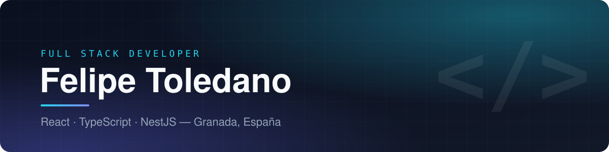
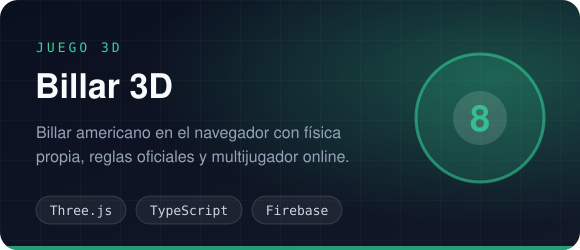
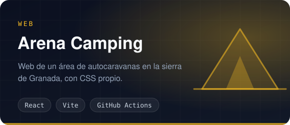
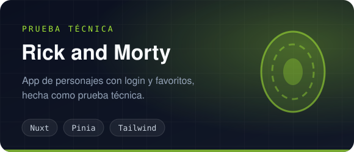
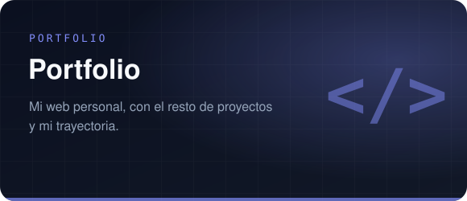

  

 

## Proyectos

Código: [Billar 3D](https://github.com/F3LIP3X/billar-game-3D) · [Arena Camping](https://github.com/F3LIP3X/ArenaCamping-web) · [Rick and Morty](https://github.com/F3LIP3X/Prueba-Tecnica-Optima-Cultura-Rick-Morty-Felipe-Jose) · [Portfolio](https://github.com/F3LIP3X/Portfolio)

## Stack

## Experiencia

| Periodo | Empresa | Rol |
|:--|:--|:--|
| Jun. 2026 — actualidad | **QUANTIA Ingeniería y Consultoría** | Programador Full Stack |
| 2026 · 3 meses | **CRM "Segures Task's"** (freelance) | Full Stack Developer |
| 2025 · 7 meses | **Hiberus IT Development** | Consultor Junior Full Stack |
| Mar. 2025 — Jun. 2025 | **Hiberus IT Development** | Consultor (prácticas) |
